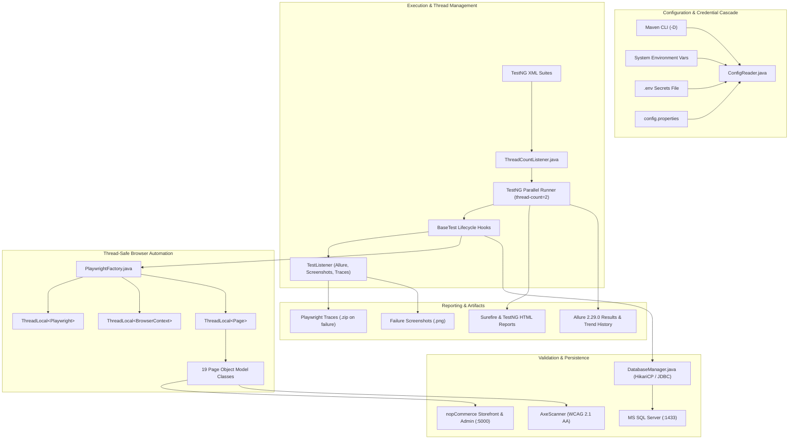
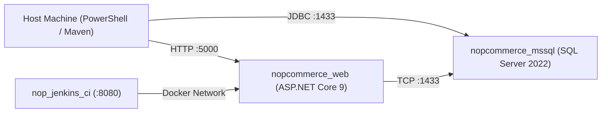

# nopCommerce E2E Test Automation Framework

[](https://www.oracle.com/java/)
[](https://playwright.dev/java/)
[](https://testng.org/)
[](https://allurereport.org/)
[](https://www.deque.com/axe/)
[](https://www.docker.com/)
[](https://www.jenkins.io/)
[](docs/execution-summary.md)

Production-grade Quality Engineering and End-to-End Test Automation framework for **nopCommerce 4.90.8** (.NET 9 on containerized Kestrel + MS SQL Server 2022). Built with **Java 21 LTS**, **Playwright Java**, **TestNG**, **Allure Report**, and **Axe-Playwright**, engineered for zero-flakiness multi-threaded parallel execution, automated CI/CD gating, and direct database persistence validation.

---

## Reconciled Execution Summary (`2026-11-25 09:04:30 UTC`)

**Execution Window:** `2026-11-25T09:03:07Z to 2026-11-25T09:04:30Z (83.00s)`
**Target AUT:** nopCommerce 4.90.8, isolated Docker stack
**Run Result:** 63 passed, 0 failed, 0 skipped (100.0% of 63 executed automated methods).

| Metric Category | Value | Source Artifact |
|---|---|---|
| Total Test Cases Specified | 108 | `docs/test-cases.csv` |
| Automated Test Methods | 63 (58.3% of catalog) | `docs/traceability-matrix.md` |
| Executed Automated Methods | 63 (100.0%) | `evidence/surefire-reports/testng-results.xml` |
| Passed / Failed / Skipped | 63 / 0 / 0 | `docs/execution-summary.md` |
| k6 Storefront Load Benchmark | k6 v0.54.0 separate HTTP browse/search workload: 25 peak VUs over 112.89s, 1013 requests, p95 257.73 ms | `evidence/performance/k6-summary.json` |

This run covers the executed automated methods only. The 63 automated methods map to a 108-case catalog; it is not 100% coverage of all planned cases.
GitHub Actions runs smoke and API suites only. A green Jenkins dispatch confirms acceptance of the request, not the downstream test result.
The axe default threshold is critical impact; critical findings fail the scan. Strict serious-impact audits can be run on demand with -Da11y.failOnImpact=serious.

## Required Secrets & Environment Variables

No credentials or fallback passwords are stored in the repository. Supply secrets via `.env` (local) or CI secrets:
- `ADMIN_EMAIL` / `ADMIN_PASSWORD`: nopCommerce administrator credentials
- `DB_USER` / `DB_PASSWORD`: MSSQL database credentials (required by `docker/docker-compose.yml` and `DatabaseManager`)
- `BASE_URL` / `ADMIN_URL`: Isolated nopCommerce test instance URLs (defaults to `http://127.0.0.1:5000`; `demo.nopcommerce.com` is rejected)
- `IGNORE_HTTPS_ERRORS`: Opt-in boolean (`false` by default)

---

## Framework Architecture & Engineering Standards



### Architectural Highlights

1. **ThreadLocal Browser Isolation**: Every parallel test thread receives an isolated `Playwright`, `BrowserContext`, and `Page` instance, eliminating cross-test session leaks, cookie contamination, or state bleed.
2. **Auto-Waiting Locators**: Page objects strictly wrap Playwright locators (`click()`, `fill()`, `selectOption()`, `waitForVisible()`) relying on native readiness checks (attached, visible, stable, enabled) with zero arbitrary `Thread.sleep()` pauses.
3. **Dynamic Concurrency Control (`ThreadCountListener`)**: Inspects parallel suite configurations at runtime and dynamically binds `-DthreadCount` overrides across TestNG runners.
4. **Hierarchical Configuration Cascade**: Resolves settings in strict priority: `CLI System Properties (-D)` > `Environment Variables` > `.env` file > `config.properties` > hardcoded fallbacks.
5. **Automated Test Data Lifecycle**: `DatabaseManager.java` manages transactional database assertions and executes allowlisted cleanup (`deleteIsolatedCustomerByEmail`) for dynamic test customer accounts, orders, cart items, reviews, and orphan addresses.
6. **Failure-Only Diagnostic Traces & Screenshots**: Playwright execution traces (`.zip`) and full-page screenshots (`.png`) are automatically captured and attached to Allure only on test failure (traces are discarded when tests pass; video recording defaults to off and records per-context when `-DrecordVideo=true`).

---

## 3. Automated Test Coverage (63 Tests Across 10 Domains)

| Domain | Test Class | Methods | Automated Coverage & Key Business Flows |
| --- | --- | :---: | --- |
| **Smoke Gate** | `SmokeTest.java` | 3 | Storefront root health, search input interactivity, admin portal login page rendering. |
| **Authentication & Identity** | `AuthTest.java` | 9 | Valid registration, duplicate email rejection, required field validation, invalid email syntax, password confirmation mismatch, valid login, invalid password, empty credentials, session logout. |
| **Catalog Browsing & Search** | `CatalogTest.java` | 7 | Top menu navigation, category desktop rendering, product details display, image gallery triggers, non-existent search handling, 3-character search warning, price sorting (low-to-high). |
| **Shopping Cart & Wishlist** | `CartTest.java` | 8 | Add simple product, view cart & verify product, update cart quantity & verify tripled subtotal, remove cart item, add to wishlist, migrate wishlist item to cart, apply valid discount coupon in isolated guest session & verify total reduction, invalid coupon rejection. |
| **Checkout Flow** | `CheckoutTest.java` | 4 | Negative & positive Terms of Service enforcement, guest checkout billing initiation, billing/shipping through Check / Money Order payment options, and complete E2E guest order confirmation with DB persistence verification (`TC-CHK-010`). |
| **Customer Account Management** | `CustomerAccountTest.java` | 6 | Customer info view/update with reload persistence verification, address book management (create, edit, delete address), order history page load, registered customer review submission, guest review restrictions. |
| **Administration Portal** | `AdminTest.java` | 7 | Admin authentication, dashboard metrics cards & header verification, product catalog grid & search, orders table display, categories list verification, customer list verification, admin invalid login validation. |
| **API Endpoint Probing** | `ApiEndpointTest.java` | 6 | Root endpoint HTTP 200, register endpoint health, login endpoint health, 404 route handling, unauthenticated `/Admin` HTTP 302 redirect to login, anti-forgery CSRF token enforcement (HTTP 400 Bad Request). |
| **Database Persistence** | `DatabaseVerificationTest.java` | 4 | JDBC connectivity health check (`SELECT 1`), customer record persistence in `Customer` table, shopping cart row + quantity + product verification (`ShoppingCartTypeId=1`), seeded order & order-items verification in `[Order]`. |
| **Accessibility Compliance** | `AccessibilityTest.java` | 5 | Automated WCAG 2.1 AA scans with axe-core across Homepage, Registration, Login, Shopping Cart, and Category pages with configurable impact thresholds (`RSK-012` documents upstream `DEF-A11Y-001` contrast debt). |
| **Non-Functional & SLA** | `NonFunctionalTest.java` | 4 | Full document load + header visibility SLA (`< 15000ms` via `System.nanoTime()`), desktop (`1920x1080`) & mobile (`375x667`) responsive layout + zero overflow check, mobile menu trigger, zero HTTP 5xx server errors on loaded page assets. |

---

## 4. Known Upstream Findings & Accessibility Reality

In strict adherence to professional QA transparency, known upstream platform defects are documented rather than masked:

### Upstream Theme Color-Contrast Finding (`DEF-A11Y-001`)

- **Finding**: nopCommerce 4.90.8's stock storefront CSS contains a known WCAG 2.1 AA `serious` color-contrast violation: white text on `#4ab2f1` primary buttons and links produces a contrast ratio of **2.35:1** (below the **4.5:1** threshold required for normal body text).
- **Quality Gate Strategy**: Because this repository is an **automation framework** testing an external containerized AUT and does not contain nopCommerce's application CSS, the automated CI gate defaults to `critical` (`a11y.failOnImpact=critical`). This ensures continuous delivery pipelines are not permanently blocked by an external application defect while functional regression remains 100% green.
- **On-Demand Strict Audit**: Accessibility auditors can run the suite in strict mode at any time to fail on serious contrast findings:

  ```powershell
  mvn test -Pa11y -Da11y.failOnImpact=serious
  ```

---

## 5. CLI Execution Cheat Sheet

### 5.0 One-Time Local Prerequisites

```powershell
# 1. Configure secrets locally (never commit .env)
Copy-Item .env.example .env
# Edit .env to set ADMIN_EMAIL, ADMIN_PASSWORD, DB_USER, DB_PASSWORD

# 2. Download Playwright browser binary (Maven skips browser auto-download by default)
mvn exec:java -e -Dexec.mainClass=com.microsoft.playwright.CLI -Dexec.args="install chromium"

# 3. Boot and verify the isolated Docker AUT stack (from Git Bash / WSL)
bash docker/bootstrap-aut.sh
```

### 5.1 Run Test Suites by Profile

```powershell
# 1. Quick Smoke Suite (3 tests, ~10s)
mvn test -Psmoke

# 2. Dedicated Parallel Storefront UI Suite (41 tests, 2 browsers)
mvn test -Pui

# 3. Full End-to-End Regression Suite (63 tests, ~1.5-2 min)
mvn test -Pregression

# 4. API Integration Probing (6 tests, ~12s)
mvn test -Papi

# 5. Database Verification Suite (4 tests, ~25s)
mvn test -Pdb

# 6. Accessibility WCAG 2.1 AA Scans (5 tests, ~15s)
mvn test -Pa11y

# 7. Non-Functional & Responsive SLA Suite (4 tests, ~20s)
mvn test -Pnfr
```

### 5.2 Targeted Test Execution

```powershell
# Run a specific test class
mvn test -Dtest=CartTest

# Run a single test method
mvn test -Dtest=CartTest#testAddProductToCart

# Run multiple test classes
mvn test -Dtest=AuthTest,CartTest,CheckoutTest
```

### 5.3 Execution Modes & Debugging Flags

```powershell
# Run in Headed mode (opens visible browser windows)
mvn test -Pui -Dheadless=false

# Run in Slow Motion (500ms pause per action for live demonstration)
mvn test -Dtest=CartTest -DslowMo=500 -Dheadless=false

# Override thread count dynamically
mvn test -Pui -DthreadCount=4

# Run against a different browser engine (chromium, firefox, webkit)
mvn test -Psmoke -Dbrowser=firefox
```

### 5.4 Allure Reporting

```powershell
# Generate static Allure HTML report to target/site/allure-maven-plugin/
mvn allure:report

# Start local web server with interactive Allure dashboard
mvn allure:serve
```

---

## 6. Infrastructure, Docker & Local Environment

The framework runs against an isolated, reproducible Docker stack:



### Starting the AUT Stack

```powershell
# Safe bootstrap: parses required secrets from .env and verifies health
bash docker/bootstrap-aut.sh

# Verify running container health
docker ps --format "table {{.Names}}\t{{.Status}}\t{{.Ports}}"
```

Required environment variables or `.env` entries:

- `BASE_URL`: Defaults to `http://127.0.0.1:5000` (public `demo.nopcommerce.com` is rejected at startup).
- `ADMIN_URL`: Defaults to `http://127.0.0.1:5000/Admin`.
- `DB_USER` / `DB_PASSWORD`: MSSQL database credentials (default: `sa` / password configured in `.env`).

---

## 7. Continuous Integration & Pipeline Architecture

### GitHub Actions CI (`.github/workflows/smoke-gate.yml`)

- Triggered automatically on pushes to `main` and `refactor/**`, and pull requests targeting `main`.
- Spins up an ephemeral, isolated nopCommerce and MS SQL Docker stack on `ubuntu-latest`.
- Pre-seeds the database snapshot using `docker/seed/nopcommerce_baseline.bak`.
- Executes both the **Browser Smoke Suite** and **API Probe Suite**.
- Runs `python3 scripts/reconcile_rtm.py --verify-only` to validate RTM parity without overwriting committed regression baselines, and uploads Allure + Surefire CI artifacts.

### Local Jenkins CI Pipeline (`jenkins/Jenkinsfile`)

- Enterprise Declarative Pipeline running on `http://localhost:8080/job/nopCommerce-E2E-Automation-Pipeline/`.
- Full parameterization support (`SUITE`, `BROWSER`, `HEADLESS`, `THREAD_COUNT`, `ENABLE_TREND_HISTORY`).
- Automatically injects Jenkins credentials (`nop-admin-email`, `nop-admin-password`, `nop-db-user`, `nop-db-password`).
- Verifies container health on `http://nopcommerce_web`, sets up Playwright drivers, runs the suite with 2 worker threads, syncs the RTM, and archives Allure trend history.

---

## 8. Test Reports & Evidence Location

| Report Type | Path / URL | Description |
| --- | --- | --- |
| **TestNG Full HTML Suite Report** | [evidence/surefire-reports/index.html](evidence/surefire-reports/index.html) | Complete test class breakdown and execution logs. |
| **TestNG Emailable Report** | [evidence/surefire-reports/emailable-report.html](evidence/surefire-reports/emailable-report.html) | Single-page summary table with timings and statuses. |
| **Allure HTML Report** | `target/site/allure-maven-plugin/index.html` | Interactive dashboard with step trees, charts, and history. |
| **Axe Accessibility Scans** | [evidence/a11y/](evidence/a11y/) | Raw JSON violation trees for all 5 scanned pages. |
| **Requirements Traceability Matrix** | [docs/traceability-matrix.md](docs/traceability-matrix.md) | Granular 1:1 mapping of requirements to test code. |
| **Test Execution Summary** | [docs/execution-summary.md](docs/execution-summary.md) | Reconciled pass/fail metrics and duration benchmarks. |
| **Formal QA Sign-Off** | [docs/qa-sign-off.md](docs/qa-sign-off.md) | Verified QA sign-off and risk assessment document. |
| **Failure Screenshots & Traces** | `evidence/failures/`, `evidence/traces/` | Retained zip traces and failure images for debugging. |

---

## 9. Repository Structure

```text
├── src/test/java/com/qa/nopcommerce/
│   ├── annotation/     # @TestCase annotation mapping tests to requirements & CSV catalog
│   ├── base/           # BaseTest lifecycle hooks, context management, tracing & cleanup
│   ├── config/         # ConfigReader with 5-tier cascade and validation
│   ├── database/       # DatabaseManager for HikariCP JDBC pooling, SQL queries & customer cleanup
│   ├── factory/        # PlaywrightFactory for ThreadLocal browser and page instances
│   ├── listeners/      # TestListener (Allure/screenshots) & ThreadCountListener (parallelism)
│   ├── pages/          # 19 Page Object implementations with auto-wait actions
│   └── tests/          # 11 Test classes across UI, API, DB, Smoke, A11y, and NFR
├── src/test/resources/
│   ├── config/         # config.properties repository defaults
│   └── suites/         # 7 TestNG XML suite definitions
├── docker/             # Docker Compose, bootstrap script, and database baseline backup
├── jenkins/            # Jenkinsfile and declarative pipeline job configurations
├── .github/workflows/  # GitHub Actions CI gate definitions
├── docs/               # Requirements, risk register, test strategy, RTM, and sign-off docs
├── evidence/           # Retained Surefire XML/HTML reports (sanitized) and Axe scan outputs
└── scripts/            # Python reconciliation & evidence-scrubbing script for RTM docs
```

---

## 10. QA Lead & Author

- **Author & QA Automation Engineer:** Deependra Singh
- **Target Application:** nopCommerce 4.90.8 (.NET 9 + MS SQL Server)
- **Status:** **Active / Verified — 63/63 Automated Tests Passing (100% Pass Rate)**
